# 🐳 미션1. 내 컴퓨터에 개발자용 '작업실' 꾸미기

---
## ⚠️ 시작 전 핵심 규칙 3가지
```
❌ 절대 금지: /mnt/c/... 경로에 파일 저장 
❌ 절대 금지: \\wsl.localhost\... 경로로 작업 -> # 속도가 느려지고, chmod 755/644 권한이 깨어짐
✅ 반드시: 모든 파일은 Linux 홈(~/) 안에 저장 -> # Ex. project파일, Docker, VS Code, 터미널 모두 리눅스 폴더를 바라보도록 만들 것.
```

> 🏫 랩 PC 사용 중이라면?
> 다른 PC로 가면 WSL·Docker·파일 전부 사라짐
> 작업 후 반드시 코드 → git push & 파일 -> 클라우드(OneDrive·Drive) 백업!
---

## 📋 전체 순서 한눈에 보기

| 단계 | 실행 위치 | 내용 |
|------|-----------|------|
| 0단계 | Windows PowerShell (관리자) | WSL + Ubuntu 설치 |
| 1단계 | Ubuntu 터미널 | 기본 도구 설치 + 작업 폴더 생성 |
| 2단계 | Ubuntu 터미널 | Git · GitHub 설정 |
| 3단계 | Ubuntu 터미널 | 작업 디렉토리 생성 + 터미널 기본 조작 |
| 4단계 | Ubuntu 터미널 | 권한 실습 (chmod) |
| 5단계 | Windows → Ubuntu | Docker 설치 및 동작 확인 |
| 6단계 | Ubuntu 터미널 | 기본 컨테이너 실습 |
| 7단계 | Ubuntu 터미널 | 웹서버 컨테이너 만들기 |
| 8단계 | Ubuntu 터미널 | 포트 매핑 확인 |
| 9단계 | Ubuntu 터미널 | 바인드 마운트 확인 |

---

## 0단계. WSL 설치(Windows Subsystem for Linux)

> 💡 Ubuntu(리눅스)를 Windows 안에 설치하는 단계임
> ⚠️ 실행 위치: **Windows PowerShell (관리자 권한)**

### 0-1. 가상화 확인 (권장)

```powershell
# 작업 관리자 → 성능 → CPU → '가상화: 사용' 확인
# 또는 아래 명령으로 확인 (하나라도 True면 OK)
Get-CimInstance Win32_Processor | Select VirtualizationFirmwareEnabled
Get-CimInstance Win32_ComputerSystem | Select HypervisorPresent
```

출력 스크린샷 참조: 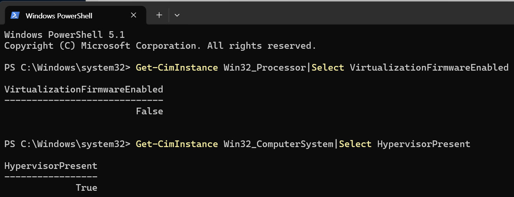

✅ **확인**: 하나라도 `True` → 다음 진행
❌ **둘 다 False** → BIOS에서 Intel VT-x / AMD SVM 켜기

---

### 0-2. WSL + Ubuntu 설치

```powershell
wsl --install
```

✅ **확인**: 설치 완료 메시지 → **PC 재부팅**

> 💡 재부팅 후 Ubuntu 창이 자동으로 안 열리면?
> PowerShell에서 아래 명령 실행:
> ```powershell
> wsl --install -d Ubuntu
> ```


출력 스크린샷 참조: 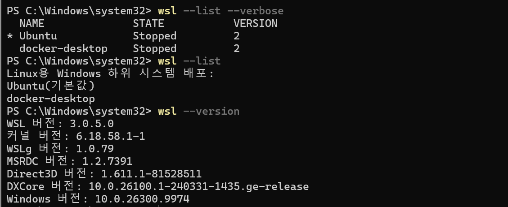 

---

### 0-3. Linux 사용자 만들기 (Ubuntu 첫 실행)

```
사용자 이름: (소문자, 공백 없이 입력)   예) jung
비밀번호:   (입력해도 화면에 안 보임 → 정상!)
```

✅ **확인**: 프롬프트가 `사용자명@컴퓨터명:~$` 로 바뀌면 성공!


출력 스크린샷 참조: 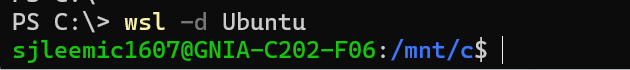

---

### 0-4. WSL2 확인 & 커널 업데이트

```powershell
# 다시 PowerShell에서 실행
wsl -l -v        # Ubuntu가 VERSION 2 인지 확인
wsl --update     # WSL 커널 최신화
```

✅ **확인**: VERSION 칸이 `2` 면 완료!


출력 스크린샷 참조 : 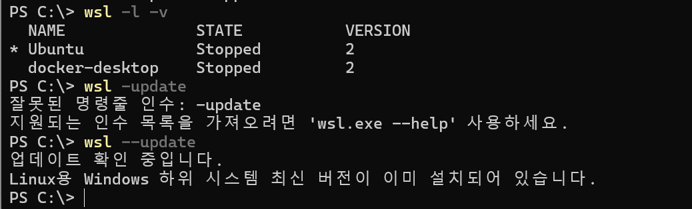

---

## 1단계. 기본 준비

> 💡 개발에 필요한 기본 도구를 설치하는 단계임
> ⚠️ 실행 위치: **Ubuntu 터미널**

### 1-1. 시스템 업데이트

```bash
sudo apt update && sudo apt upgrade -y
```

✅ **확인**: 오류 없이 완료되면 OK
> 💡 비밀번호 입력 시 화면에 안 보이는 건 정상임

출력 스크린샷 참조 : 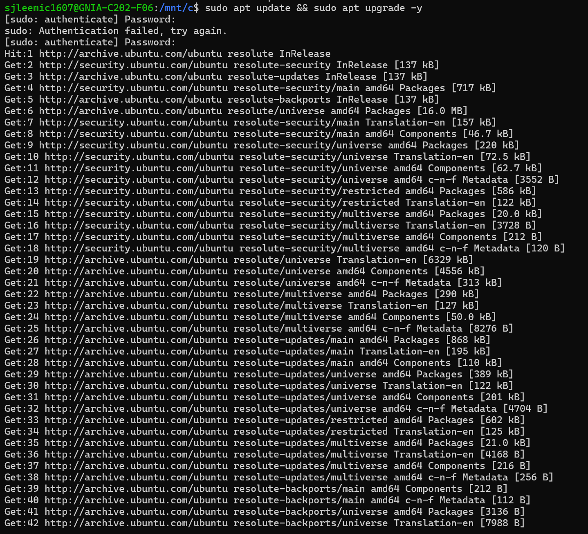

---

### 1-2. 필수 도구 설치

```bash
sudo apt install -y build-essential curl wget git unzip
```

✅ **확인**:
```bash
git --version
curl --version
```

출력 스크린샷 참조 :  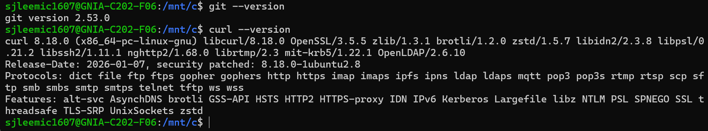 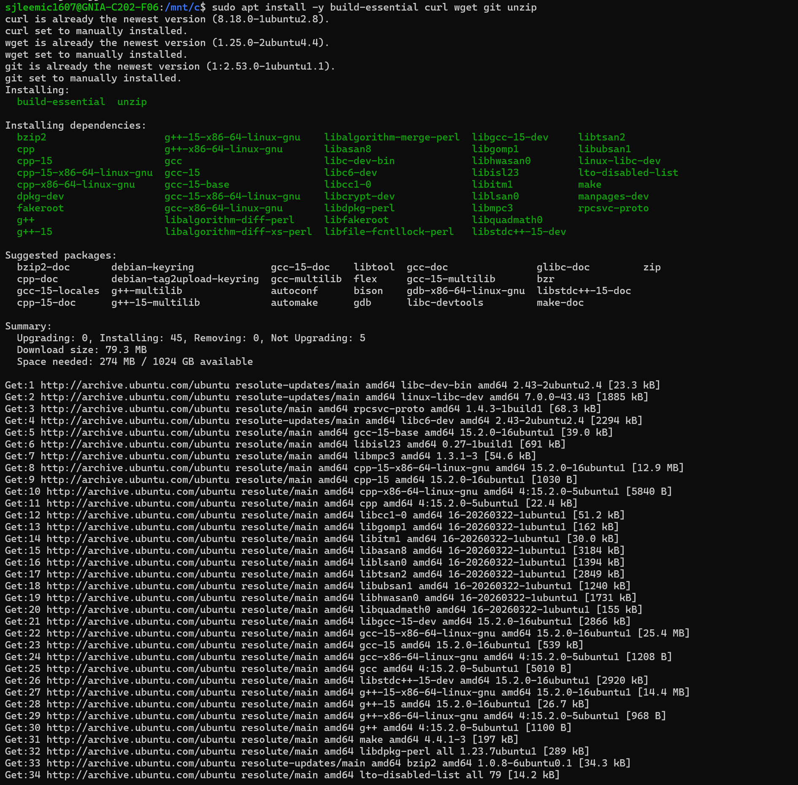

---

### 1-3. 프로젝트 폴더 만들기

```bash
cd ~                          # 홈으로 이동 (항상 여기서 시작!)
mkdir -p ~/projects           # 프로젝트 담을 폴더 (한 번만)
cd ~/projects
mkdir dev-workstation
cd dev-workstation
pwd                           # 현재 위치 확인
```

✅ **확인**: `pwd` 결과가 `/home/사용자명/projects/dev-workstation` 이면 성공!

> ❌ Permission denied 떴다면?
> 폴더 이름 앞에 `/` 붙이지 마세요! (`mkdir /myapp` ✗ → `mkdir myapp` ✅)


출력 스크린샷 참조 : 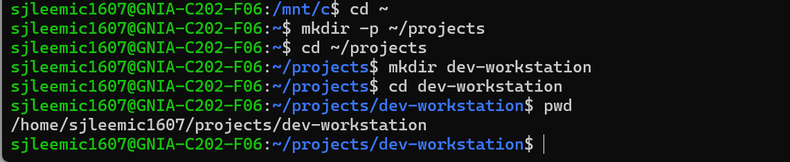

---

## 2단계. Git · GitHub 설정

> 💡 내 커밋에 이름표를 붙이는 단계임
> ⚠️ 실행 위치: **Ubuntu 터미널**

### 2-1. Git 사용자 설정

```bash
git config --global user.name "본인 이름"
git config --global user.email "github계정@example.com"
git config --global init.defaultBranch main
```

✅ **확인**:
```bash
git config --global --list
```

출력 스크린샷 참조 : 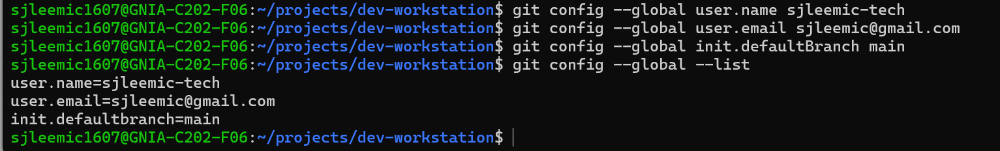

---

### 2-2. GitHub CLI 설치 & 로그인

```bash
sudo apt install -y gh
gh auth login     # 브라우저로 GitHub 로그인
```

✅ **확인**:
```bash
gh auth status    # 로그인됨 표시 확인
```

> 💡 `gh auth login` 에서 **HTTPS + 브라우저로 인증** 선택이 가장 쉬움
---

출력 스크린샷 참조 : 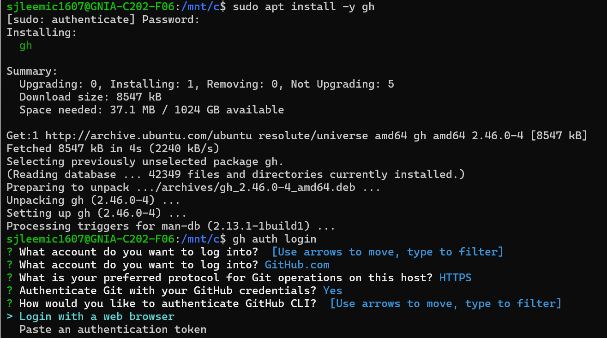 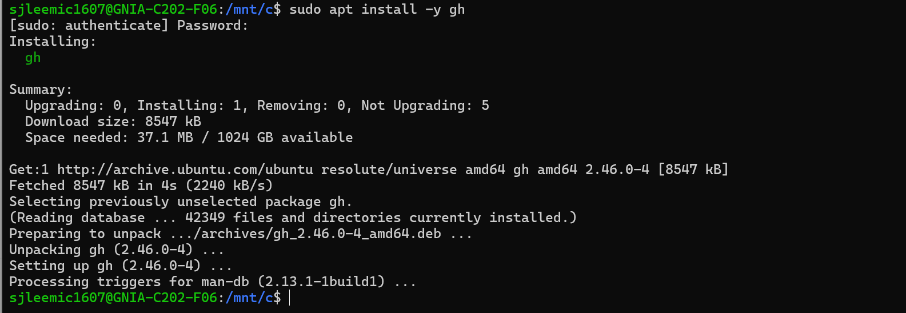 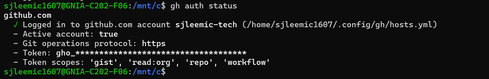

## 3단계. 작업 디렉토리 생성 + 터미널 기본 조작

> 💡 파일과 폴더를 다루는 기본 명령어 연습
> ⚠️ 실행 위치: **Ubuntu 터미널**

### 3-1. 작업 디렉토리 생성

```bash
cd ~/projects/dev-workstation
git init
pwd
ls
ls -Force
```

✅ **확인**: `pwd` 로 현재 위치, `ls` 로 파일 목록 확인


출력 스크린샷 참조 :  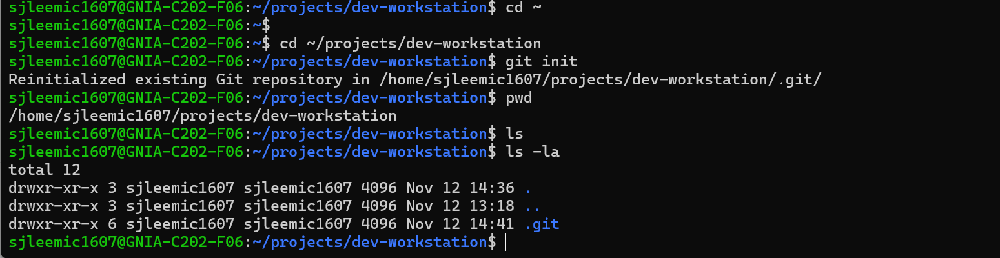

---

### 3-2. 터미널 기본 조작 실습

```bash
pwd                              # 현재 위치 확인
cd ..                            # 한 단계 위로 이동
mkdir sample                     # sample 폴더 생성
cd sample                        # sample 폴더로 이동
touch test.txt                   # test.txt 파일 생성
echo "hello" > test.txt          # 파일에 내용 쓰기
cat test.txt                     # 파일 내용 읽기  → hello 출력되면 성공!
cp test.txt test_copy.txt        # 파일 복사
mv test_copy.txt renamed.txt     # 이름 바꾸기
rm renamed.txt                   # 파일 삭제
touch empty.txt                  # 빈 파일 생성
```

✅ **확인**: `cat test.txt` 실행 시 `hello` 출력되면 성공!

---


출력 스크린샷 참조 : 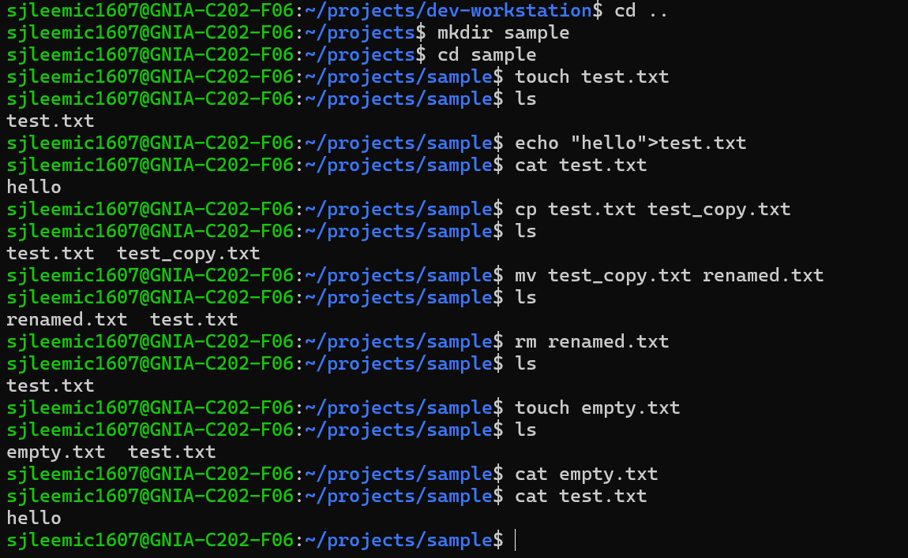

## 4단계. 권한 실습

> 💡 파일에 자물쇠(권한)를 거는 연습임
> ⚠️ 실행 위치: **Ubuntu 터미널**

```bash
cd ~/projects/dev-workstation
ls -l                  # 현재 권한 확인
chmod 644 test.txt     # 파일 권한 설정 (소유자 읽기/쓰기, 나머지 읽기만)
chmod 755 sample       # 폴더 권한 설정 (소유자 모두, 나머지 읽기/실행)
ls -l                  # 변경된 권한 확인
```

✅ **확인**: `ls -l` 에서 파일 앞에 `-rw-r--r--` 같은 권한 표시 확인

> 💡 권한 숫자 의미:
> - `644` = 나만 수정 가능, 다른 사람은 읽기만
> - `755` = 나는 모두 가능, 다른 사람은 읽기+실행만

---

출력 스크린샷 참조 : 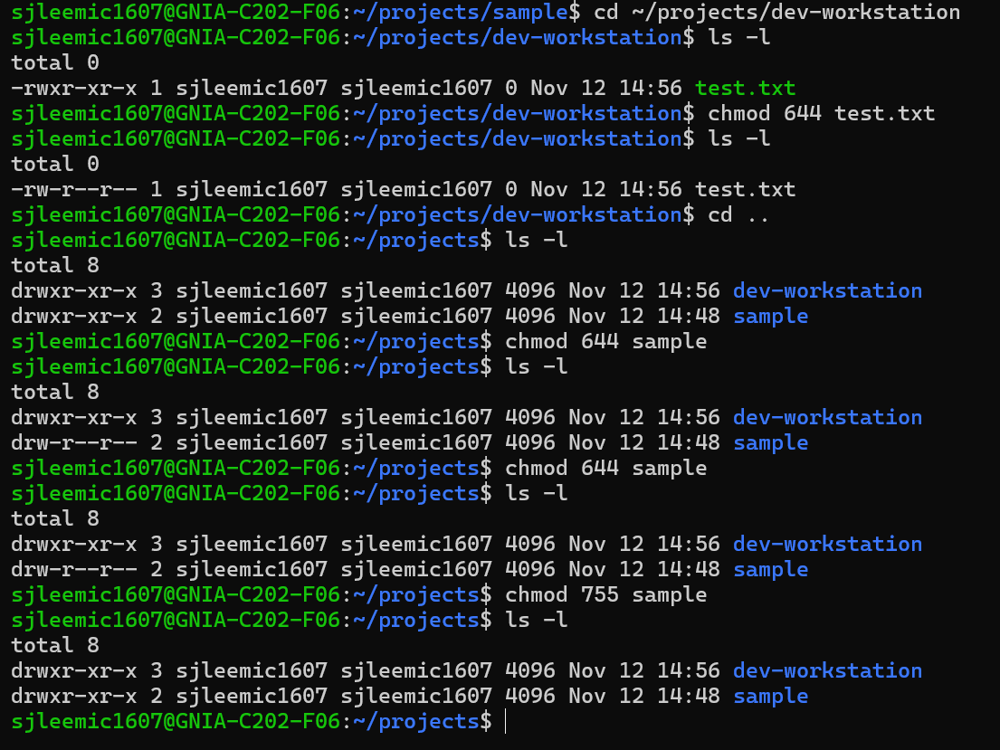

## 5단계. Docker 설치 및 동작 확인

> 💡 Docker를 설치하고 WSL과 연결하는 단계예요!
> ⚠️ 실행 위치: **Windows (설치)** → **Ubuntu 터미널 (확인)**

### 5-1. Docker Desktop 설치 (Windows)

```powershell
# PowerShell에서 실행
winget install -e --id Docker.DockerDesktop
```

또는 직접 다운로드: https://www.docker.com/products/docker-desktop/

✅ **확인**: Docker Desktop 실행 → 좌하단 고래 아이콘이 초록색

출력 스크린샷 참조 : 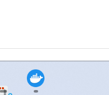 

---

### 5-2. WSL2 통합 설정 (Docker Desktop)

```
Docker Desktop → Settings(⚙️)
→ classic view(클래식 보기)로 전환  ← 이게 안 보이면 이걸 먼저!
→ Resources → WSL Integration
→ 'Enable integration with my default WSL distro' → ON
→ Ubuntu 토글 → ON
→ Apply & Restart
```


출력 스크린샷 참조 : 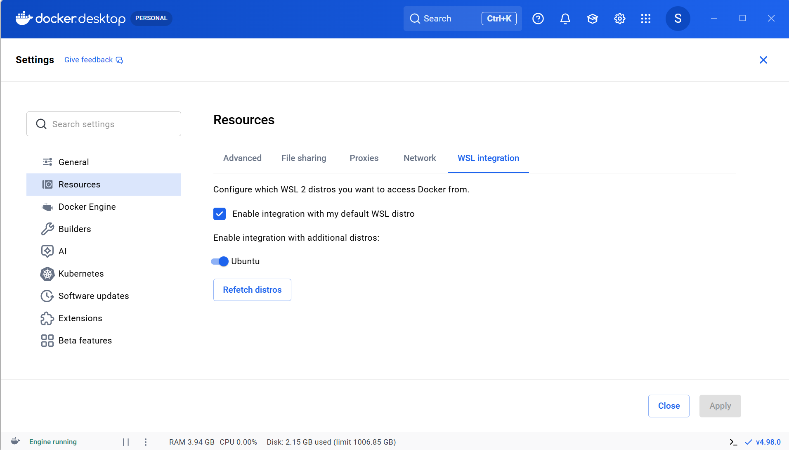

---

### 5-3. Ubuntu에서 Docker 확인

```bash
# Ubuntu 터미널에서 실행
docker --version
docker info
```

✅ **확인**: `Docker version 숫자` 출력되면 성공!

> ❌ `permission denied` 오류 시:
> ```bash
> sudo usermod -aG docker $USER
> # Ubuntu 터미널 닫았다가 다시 열기
> ```

출력 스크린샷 참조 : 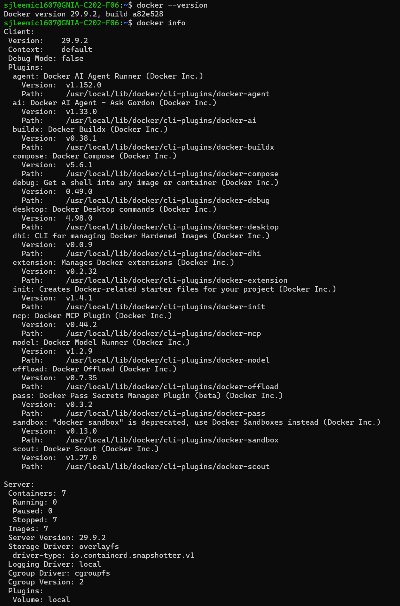 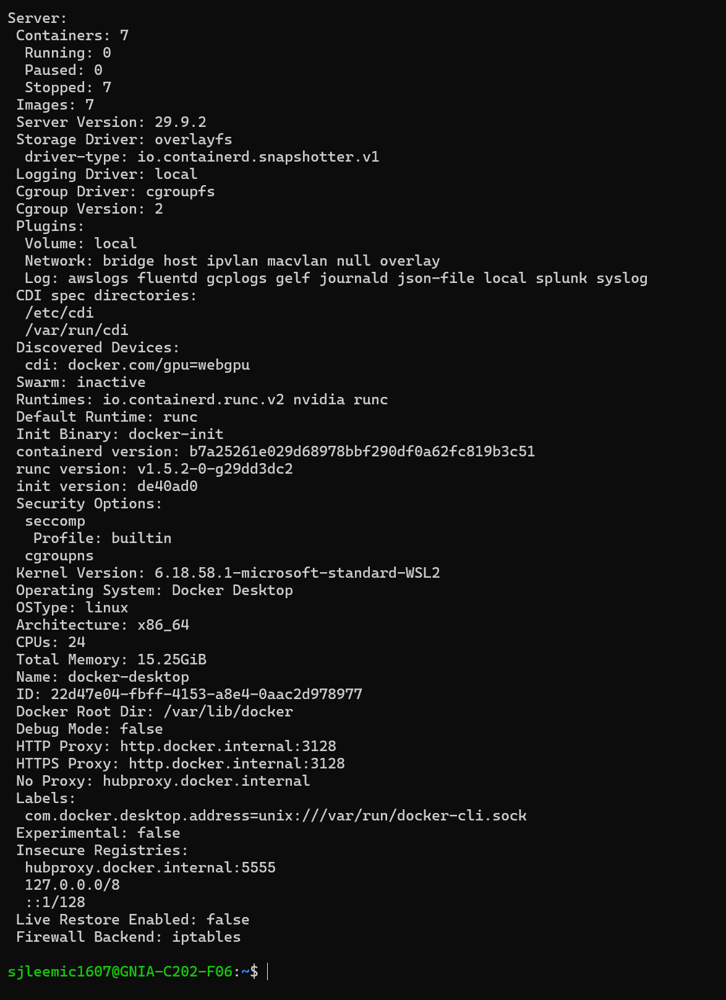

---

## 6단계. 기본 컨테이너 실습

> 💡 Docker 컨테이너를 처음 만져보는 단계임
> ⚠️ 실행 위치: **Ubuntu 터미널**

### 6-1. hello-world 컨테이너

```bash
docker run hello-world
```

✅ **확인**: `Hello from Docker!` 메시지 보이면 성공!


출력 스크린샷 참조 : 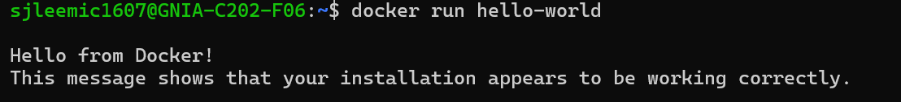 

---

### 6-2. Ubuntu 컨테이너 실행

```bash
docker run -it ubuntu bash    # Ubuntu 컨테이너 안으로 들어가기
ls                            # 컨테이너 안에서 실행
echo hello
exit                          # 컨테이너 나오기
```

---

출력 스크린샷 참조 : 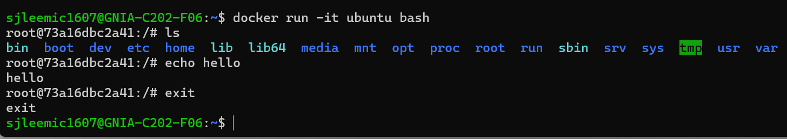

### 6-3. 컨테이너 상태 확인

```bash
docker ps        # 현재 실행 중인 컨테이너
docker ps -a     # 종료된 것 포함 전체 목록
docker images    # 내려받은 이미지 목록
```

출력 스크린샷 참조 : 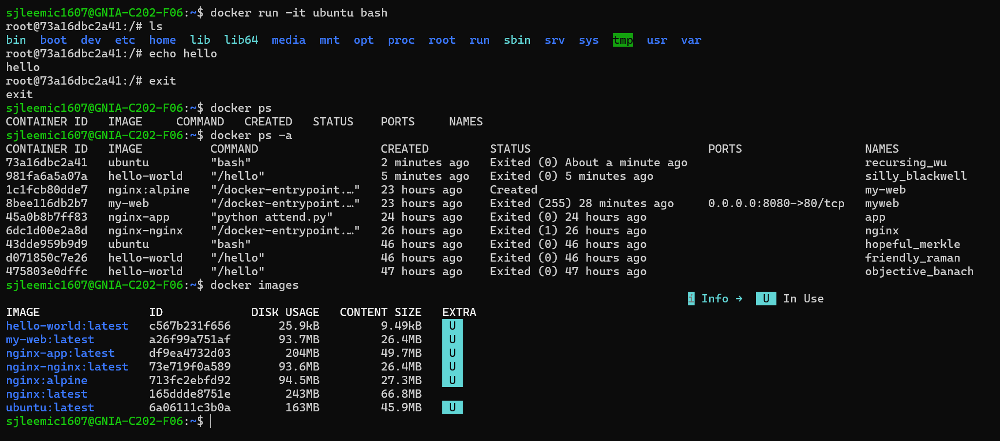

---

## 7단계. 웹서버 컨테이너 만들기

> 💡 나만의 웹사이트를 Docker로 띄우는 단계임
> ⚠️ 실행 위치: **Ubuntu 터미널**

### 📁 폴더 구조 만들기

```
~/projects/dev-workstation/
├── Dockerfile
├── README.md
└── app/
    ├── index.html
    ├── attend.py
    └── requirements.txt
```

```bash
cd ~/projects/dev-workstation
mkdir -p app
```
출력 스크린샷 참조 : 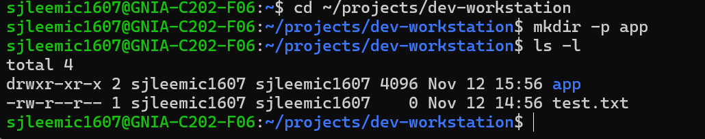
---

### 7-1. app/index.html 파일 만들기

```bash
cat > app/index.html << 'EOF'
<!doctype html>
<html>
<head><meta charset="utf-8"><title>My Server</title></head>
<body>
  <h1>Docker 웹 서버 테스트</h1>
</body>
</html>
EOF
```

출력 스크린샷 참조 : 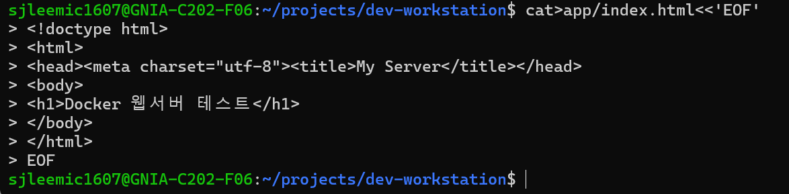

---

### 7-2. Dockerfile 만들기

```bash
cat > Dockerfile << 'EOF'
FROM nginx:alpine
COPY app/index.html /usr/share/nginx/html/index.html
EOF
```

출력 스크린샷 참조 : 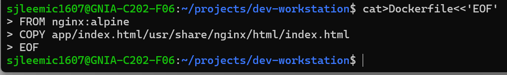

---

### 7-3. 빌드 & 실행

```bash
docker build -t my-web .
docker run -d --name my-web -p 8080:80 my-web
```

출력 스크린샷 참조 : 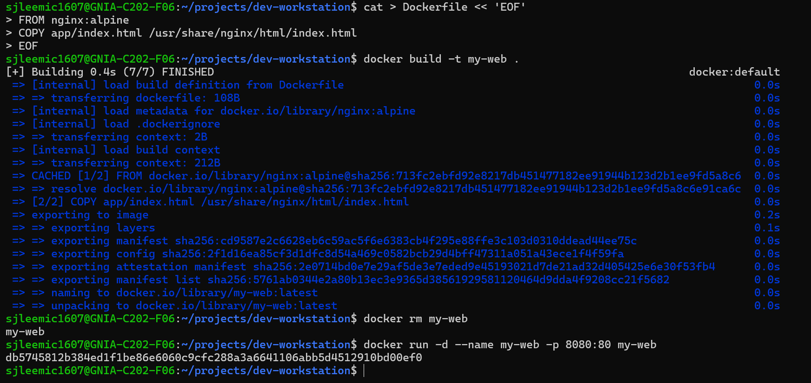

---

### 7-4. 브라우저 확인

```
Windows 브라우저 주소창에 입력:
http://localhost:8080
```

✅ **확인**: `Docker 웹서버 테스트` 글자 보이면 성공!

출력 스크린샷 참조 :  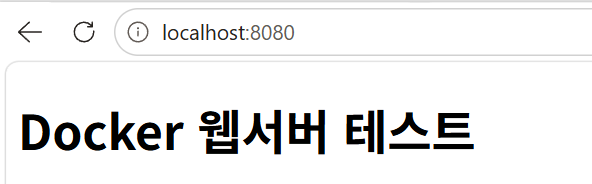

---

## 8단계. 포트 매핑 확인

> 💡 컨테이너 안 80번 포트 → 내 컴퓨터 8080번 포트로 연결하는 것임.
> ⚠️ 실행 위치: **Ubuntu 터미널**

```bash
# 기존 컨테이너 정리 후 실행
docker stop my-web
docker rm my-web
docker run -d --name my-web -p 8080:80 my-web
```

```
# 📄 README 이어서 작성

```
markdown
✅ 확인:
브라우저 → http://localhost:8080
출력: Docker 웹서버 테스트

> 💡 포트 매핑 구조:
> 내 컴퓨터 8080 ←→ 컨테이너 안 80
> 브라우저가 8080으로 접속하면 → 컨테이너 nginx가 응답함

출력 스크린샷 참조 : 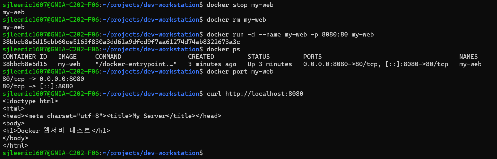 

---

## 9단계. 바인드 마운트 확인

> 💡 내 컴퓨터 폴더와 컨테이너 폴더를 실시간으로 연결하는 것임.
> 파일을 수정하면 → 브라우저에서 바로 반영됨
> ⚠️ 실행 위치: **Ubuntu 터미널**

### 9-1. 기존 컨테이너 정리

```bash
docker stop my-web
docker rm my-web
```

출력 스크린샷 참조 : 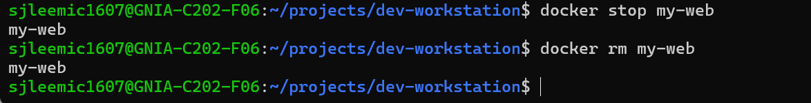

---

### 9-2. 바인드 마운트로 실행

```bash
cd ~/projects/dev-workstation
docker run -d --name my-web \
  -p 8080:80 \
  -v $(pwd)/app:/usr/share/nginx/html \
  nginx:alpine
```

✅ **확인**:
```
브라우저 → http://localhost:8080
출력: Docker 웹서버 테스트
```

출력 스크린샷 참조 : 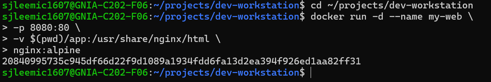

---

### 9-3. 실시간 반영 테스트

```bash
# index.html 내용 바꿔보기
cat > app/index.html << 'EOF'
<!doctype html>
<html>
<head><meta charset="utf-8"><title>My Server</title></head>
<body>
  <h1>🎉 바인드 마운트 성공!</h1>
  <p>파일을 수정했더니 바로 반영됐어요!</p>
</body>
</html>
EOF
```

✅ **확인**: 브라우저 새로고침(F5) → 내용이 바뀌면 성공!

> 💡 바인드 마운트란?
> 내 폴더(~/projects/.../app) 와 컨테이너 폴더가 실시간 연결!
> 컨테이너를 재시작 안 해도 파일 수정이 바로 반영됨

출력 스크린샷 참조 : 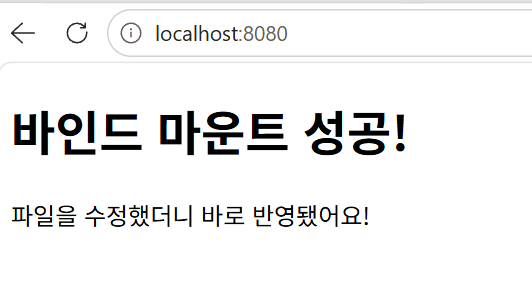

---

## 🎉 완료 체크리스트

### Part A. WSL + 리눅스 기본기
- [ ] 0단계. WSL + Ubuntu 설치 완료
- [ ] 1단계. 기본 도구 설치 + 프로젝트 폴더 생성 완료
- [ ] 2단계. Git · GitHub 설정 완료
- [ ] 3단계. 터미널 기본 조작 완료
- [ ] 4단계. 권한 실습 완료 (chmod 644/755)

### Part B. Docker 실습
- [ ] 5단계. Docker 설치 및 WSL 연동 완료
- [ ] 6단계. 기본 컨테이너 실습 완료 (hello-world, ubuntu)
- [ ] 7단계. 웹서버 컨테이너 완료 (브라우저 확인)
- [ ] 8단계. 포트 매핑 확인 완료 (8080:80)
- [ ] 9단계. 바인드 마운트 확인 완료 (실시간 반영)

---

## 🚨 문제해결

| 증상 | 원인 | 해결 |
|------|------|------|
| `permission denied` (docker) | docker 그룹 미등록 | `sudo usermod -aG docker $USER` 후 터미널 재시작 |
| `permission denied` (폴더) | 경로 앞에 `/` 붙임 | `mkdir /myapp` ✗ → `mkdir myapp` ✅ |
| 비밀번호 입력해도 안 보임 | 리눅스 정상 동작 | 그냥 치고 Enter! |
| Ubuntu 창 자동으로 안 열림 | 교육장 PC 특성 | `wsl --install -d Ubuntu` 실행 |
| `docker: command not found` | WSL 통합 미설정 | Docker Desktop → WSL Integration → Ubuntu ON |
| 브라우저에서 localhost:8080 안 열림 | 컨테이너 미실행 | `docker ps` 로 실행 중인지 확인 |
| chmod 해도 권한 안 바뀜 | /mnt/c 경로 사용 중 | 파일을 ~/projects/ 안으로 이동 후 다시 시도 |

---

## 💾 작업 후 필수 백업

```bash
# 작업 끝날 때마다 반드시 실행!
cd ~/projects/dev-workstation
git add .
git commit -m "작업 내용 간단히 적기"
git push
```

## 🚨 주의사항

> ⚠️ 랩 PC는 보관소가 아님
> git push 안 하면 다음날 전부 사라질 수 있음
```
